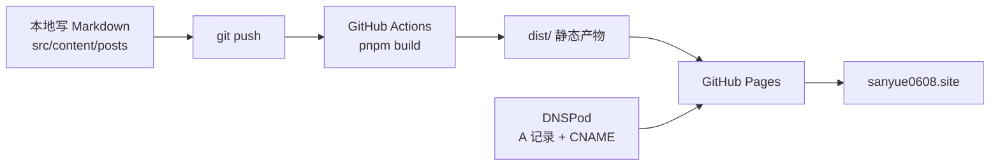

这个博客从「想搞一个」到真正能打开，花了两天。技术上的难点其实不多，难的是**每一步都有一个看起来像玄学的报错**。

把过程记下来，一是给以后的我省事，二是如果你也想搭一个，能少走我走过的弯路。

## 一、选型：为什么是 Astro

一开始的需求很朴素：能写文章、打开快、别让我维护服务器。

筛到最后剩下两个方向：WordPress 那种「动态站点」，和 Astro 这种「静态站点」。

最后选静态，理由很实际：

- 文章是 Markdown 文件，存在自己电脑上，不锁在某个平台的数据库里
- 没有数据库，就没有「数据库挂了」「被拖库了」这些事
- 构建出来的是一堆 `.html`，扔到任何静态托管上都能跑，随时可以搬家

主题选了开源的 **Shirone**——Material 3 风格、中文支持好、配置项都有中文注释。对新手来说，注释比文档管用。

## 二、五个坑

### 坑 1：主题说要 Node 26，但 EdgeOne 最高只给 22

主题的 `package.json` 写着 `engines.node: ">=26.13.0"`。我老老实实装了 Node 26，本地跑得很好。

结果一上 EdgeOne 就炸：

```
Node.js v22.x is not supported by Astro!
Please upgrade Node.js to a supported version: ">=22.23.4"
```

这里有个反直觉的地方：**主题声明的要求，往往比它依赖的框架严格得多**。我把依赖一个个翻出来看：

| 包 | 实际要求 |
|---|---|
| `astro@7.4.5` | `>=22.23.4` |
| `vite@8` | `>=22.12` |
| `svelte@5` | `>=18` |

**没有任何一个依赖真的需要 26。** 于是把 `engines.node` 改成 `>=24.0.0`，本地和线上统一到 Node 24，装依赖、构建、开发服务器全部复测通过。

> 教训：看到 `engines` 报错，先去看依赖的真实要求，别直接信主题写的数字。

而且 EdgeOne 预装的最高版本是 **22.11.0**，比 Astro 要的 `22.23.4` 还差一点点——就差这一点点，整个构建起不来。这种"差 0.12 个版本"的坑最恶心，因为报错信息看起来像是网络问题或者配置问题。

### 坑 2：字体是构建时从 CDN 下载的（最坑的一个）

本地构建偶尔失败：

```
[CannotFetchFontFile] An error occurred while fetching the font file from
https://cdn.jsdelivr.net/fontsource/fonts/jetbrains-mono@5.3.0/...
```

重跑一次又好了。我一开始以为是网络抖动。

后来清空构建缓存再跑，**必现失败**。才意识到：前面那些"成功"都是在吃缓存，真实的构建流程一直在依赖外网。

原因：主题的字体配置用的是 `source: "fontsource"`，Astro 在构建时要**实时从 jsDelivr 下载字体文件**来计算排版度量（行高、基线这些）。

这意味着：**任何一台全新克隆、没有缓存的构建机（CI、云平台）第一次构建都会挂在这里**，而且报错信息完全指向错误的方向。

修法很干脆：把字体文件复制进项目，改成 `source: "local"`。

```ts
// 之前：构建时要联网下载
source: "fontsource",

// 之后：文件就在仓库里
source: "local",
variants: [{ file: "src/assets/fonts/outfit-latin-400.woff2", weight: 400 }],
```

代价是仓库多了 122KB 的字体文件，收益是**构建全程零外网请求**，离线也能构建。这笔账很划算。

### 坑 3：EdgeOne 绑定域名要绑银行卡

Node 版本调好之后 EdgeOne 终于能构建了。但到绑定自定义域名这一步，要求填银行卡。

我能理解平台要防滥用，但一个个人博客，我确实不想为此绑卡。于是换方案。

### 坑 4：git rebase 卡在中间，仓库变成 detached HEAD

改提交作者的时候跑了个 `git rebase`，它停在了交互模式没走完：

```
interactive rebase in progress; onto 934f0fb
No commands remaining.
```

这时候的仓库处于"半完成"状态，之后的提交不会挂在任何分支上。修法是补一句 `git rebase --continue` 收尾，然后 `git push --force-with-lease`。

> `--force-with-lease` 比 `--force` 安全：远程有你不知道的新提交时它会拒绝，而不是直接覆盖。

### 坑 5：Jekyll 会把 `_astro/` 目录吃掉

GitHub Pages 默认会用 Jekyll 处理文件，而 Jekyll **忽略所有下划线开头的目录**。Astro 的产物里正好有 `_astro/`，里面是全部样式和脚本。

不处理的话：页面能打开，但**没有任何样式，白板一张**。

解法是放一个空的 `.nojekyll` 文件在产物根目录。（用 GitHub Actions 部署的话其实不会走 Jekyll，但加上没有坏处。）

## 三、最后的架构

折腾完，落成这样：



具体是：

- **代码**放 GitHub 仓库（公开，因为免费账号的 Pages 不支持私有仓库）
- **构建**交给 GitHub Actions，推一次 `main` 就自动 `pnpm install && pnpm build`
- **托管**用 GitHub Pages，产物是 `dist/`
- **域名**在 DNSPod 加四条 A 记录指向 GitHub 的 IP，`www` 走 CNAME

整套东西的成本是：域名几十块一年，其余全免费。

日常更新就三步：

```powershell
# 写文章
pnpm new-post 文章名
# 本地看效果
pnpm dev
# 推上去，2-3 分钟后线上更新
git add . && git commit -m "post: 新文章" && git push
```

## 四、给同样想搭博客的人

如果你完全不懂前端，也想搞一个：

1. **先想清楚"为什么"**。技术选型会变，理由不会。我是想要一个"不会被算法决定顺序、也不会被平台随时关掉"的地方。
2. **静态站点是新手最省心的选择**。没有服务器要维护，没有数据库会挂，搬家成本几乎为零。
3. **报错先看第一行**。这次两个大坑——Node 版本、字体 CDN——真正的错误都在日志最上面，而平台日志默认展示的往往是最后几行"失败"信息。
4. **"重跑一次就好了"是危险信号**。它通常意味着有缓存掩盖了真实问题，等换到干净环境就会必现。
5. **别怕推翻方案**。EdgeOne 那条路我折腾了大半天，发现要绑卡就立刻换 GitHub Pages，两小时搞定。沉没成本不该影响决策。

## 最后

这个站现在还很空：一篇文章、一条动态、一个系列。

但至少它是活的——我能往里写东西，写完推一下，它就在那儿了。

下一篇大概会写「怎么把首页改成我想要的样子」，毕竟现在用的还是主题自带的图。
