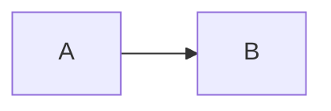

# 我的博客 · 使用手册

> 这份文档是给「第一次做博客」的人看的。前半部分解释你现在拥有了什么，后半部分是操作步骤。
> 主题官方文档：https://docs.shirone.mysqil.com/

---

## 0. 你现在的状态

| 项目 | 状态 |
| --- | --- |
| 主题源码 | 已下载到 `D:\MyBlog`，并提交为本地 git 仓库（3 次提交） |
| 运行环境 | **Node 24.21.0 + pnpm 11.28.2**，就是你系统里原本那套，没装任何额外运行时 |
| 依赖 | 已安装（`node_modules/`，1383 个包） |
| 站点信息 | 已改成「叁月的博客 / 叁月」，界面语言 `zh_CN` |
| 第一篇文章 | `src/content/posts/hello-world.md`（已归入系列「建站日志」） |
| 第一条动态 | `src/content/moments/2026-11-11-hello.md` |
| 关于页 | `src/content/spec/about.md` |
| 主题示例文章 | 已移到 `_reference/demo-content/`（不进构建，随时可查语法） |
| 字体 | 全部改为**本地文件**，构建不再依赖任何外网 CDN（原因见 §8） |
| 构建 | `pnpm build` 通过；`astro check` 0 error / 0 warning；产物 `dist/` |
| 上传包 | `dist.zip`，可直接拖到 EdgeOne |

还没做、需要你本人操作的：注册腾讯云、注册 GitHub、把站点传到线上。这些要你的账号和实名认证，我替不了。

---

## 0.5 为什么一个空博客占了 1GB？

**结论：正常，而且其中 84% 根本不会上传到任何地方。**

| 目录 | 大小 | 是什么 | 能删吗 |
| --- | --- | --- | --- |
| `node_modules/` | **920 MB** | 开发依赖：构建工具、语法高亮、图表库… | 能。删了 `pnpm install` 就能装回来（要几分钟） |
| `_reference/` | 32 MB | 我搬出来的示例文章和示例音频 | 能。确认不需要参考语法后直接删 |
| `dist/` | 29 MB | 构建产物（要上传的就是它） | 能。`pnpm build` 重新生成 |
| `.git/` | 27 MB | 版本历史 | 不建议删（删了就丢历史） |
| `.shirones/` | 27 MB | 主题的构建缓存 | 能，会自动重建 |
| `src/` + `public/` | 34 MB | 你的源码和图片（其中 14.5MB 是一个中文字体） | 部分能 |

几件事需要说清楚：

1. **`node_modules` 大是这类项目的常态。** 里面最占地方的是 `mermaid`（118MB，画流程图用的）、`@biomejs`（75MB，代码检查器）、`typescript`（两套共 87MB，被不同工具各自依赖）。真正跑网站时用不到的占大多数，但它们是构建期的工具，缺了构建就失败。
2. **`node_modules` 和 pnpm 的全局仓库是硬链接关系**，`D:\.pnpm-store` 那 860MB 并没有真的再占一份磁盘。
3. **推到 GitHub 的只有 36MB。** `.gitignore` 已经把 `node_modules/`、`dist/`、`_reference/`、`dist.zip` 全部排除，实际跟踪 893 个文件、35.9 MB，最大的是那个 14.5MB 的中文字体。
4. **上传到 EdgeOne 的是 `dist/`，29MB / 493 个文件。** 访客下载的只是首屏那点东西（HTML + 一个样式表 + 按需加载的 JS），不是 29MB。

所以「1GB」是**开发环境**的体积，不是「网站」的体积，也不是「仓库」的体积。三者别混。真想瘦身：删 `_reference/`（-32MB）和 `dist.zip`（-22MB），或者需要时再 `pnpm install`。

---

## 1. 先把六个名词搞懂

不搞懂这些，后面每一步都会像在背咒语。

**① 静态站点（static site）**
传统博客（WordPress）是「有访客来 → 服务器现场查数据库 → 生成页面」。静态站点反过来：**在你电脑上提前把所有页面生成成一堆 .html 文件**，访客来的时候服务器只负责把文件递过去。
好处：快、便宜、数据库挂了也不影响、几乎不可能被拖库。
代价：写新文章要「重新生成一次」，不能在网页后台点发布。

**② 构建（build）**
就是上面说的「生成」动作，命令 `pnpm build`：把 `src/` 里的源码 + 你的文章，变成 `dist/` 里的成品。
`dist/` 是**产物**，每次构建都被覆盖。**永远不要在 `dist/` 里改东西**，改了下次构建就没了。

**③ 托管（hosting）**
存放 `dist/` 让别人能访问的服务。我们选 EdgeOne Pages（腾讯云的静态托管，有免费额度，国内访问快）。

**④ 域名（domain）**
`example.com` 这种。EdgeOne 会先给一个免费默认域名（形如 `xxx.edgeone.app`），能直接用；以后想换成自己的域名再绑。

**⑤ DNS 解析**
把域名「指向」托管平台的服务器。在域名商后台加一条 CNAME 记录，等于告诉全世界「访问我这个域名，去 EdgeOne 那台机器拿文件」。

**⑥ Git / GitHub**
Git 是本地版本管理（已在 `D:\MyBlog` 初始化）。GitHub 是网上的代码仓库。
代码推到 GitHub 后，EdgeOne 能「连着这个仓库」，你一推代码它自动重新构建——这就是「推一下，网站就更新了」。

> 备案：以后绑自己的域名、且要国内节点全速访问，中国大陆要求域名做 ICP 备案（免费，但要时间）。**没备案也能用**，EdgeOne 会把流量调度到境外/边缘节点。先用默认域名，不影响你现在就上线。

---

## 2. 本地怎么看效果

打开 PowerShell，一次一行：

```powershell
Set-Location D:\MyBlog
pnpm dev                      # 开发模式，改文件浏览器里立刻刷新
```

浏览器打开 **http://localhost:4321**。`Ctrl+C` 停止。

看「真正上线后的样子」：

```powershell
pnpm build      # 生成 dist/
pnpm preview    # 用 dist/ 起的服务器，和线上一致
```

`pnpm dev` 和 `pnpm preview` 的区别：前者边改边看（慢一点、带调试代码），后者是成品。**判断「能不能发布」只看 `pnpm build` 是否成功。**

> 如果命令提示 `pnpm` 不是内部或外部命令，说明 Node 没装好或没加到 PATH。`node --version` 应该输出 `v24.x`。

---

## 3. 把它改成你自己的

需要改的都在 `src/config/`，**每个字段上面都有中文注释**，直接读文件最准。最小集合是这三个：

### 3.1 站点信息 —— `src/config/siteConfig.ts`

```ts
site: "https://example.com/",   // ← 必须改！上线后填你的正式域名（末尾留斜杠）
base: "/",                      // 部署在域名根目录就保持 "/"
title: "叁月的博客",             // 站点名（顶栏、Banner、RSS）
subtitle: "把日常写成可以翻阅的样子",
lang: "zh_CN",                  // 界面语言：en / zh_CN / zh_TW / ja / ko / es / id / th / tr / vi
```

`site` 为什么重要：RSS、Sitemap、分享卡片里的链接都是用它拼的绝对地址。**填错了站点照样能打开，但订阅和分享会指向错地方。** 换域名后必须改这里 + 重新构建。

同文件里还有：

- `themeColor.hue`（0–360）—— 全站主色的种子色。现在 315 是粉紫；改 262 变紫、250 变蓝、140 变绿。改一个数字，整套配色自动重算。
- `banner` —— 首页大图。默认图在 `src/assets/images/banner/`，替换成你的图即可（同名最省事）。
- `banner.homeText.subtitle` —— 打字机效果的几行小字。
- `texture` —— 背景纹理。

### 3.2 个人资料 —— `src/config/profileConfig.ts`

头像、昵称、简介、社交链接。头像放进 `src/assets/images/`，写相对 `src` 的路径（构建时自动压成 WebP/AVIF）。

### 3.3 导航 —— `src/config/navBarConfig.ts`

顶栏入口。`LinkPresets` 是预设表，`links` 数组决定顺序。想挂自己的 GitHub，就改 `LinkPresets.GitHub.url`，再把注释掉的那行取消注释。

> 想删掉某个功能页：去它对应的 `*Config.ts` 把 `enable` 改成 `false`，导航入口自动消失，不会留下点进去 404 的死链。

### 3.4 哪些页面现在是「示例数据」

| 页面 | 内容文件 | 开关 |
| --- | --- | --- |
| 友链 | `src/data/friends.ts`（现在是 Astro / Material 3 等参考站） | `friendsConfig.ts` |
| 番剧 | `src/data/anime.ts` | `animeConfig.ts` |
| 相册 | `public/images/albums/` | `albumsConfig.ts` |
| 项目 | `src/data/projects.ts` | `projectsConfig.ts` |
| 技能 | `src/data/skills.ts` | `skillsConfig.ts` |
| 设备 | `src/data/devices.ts` | `devicesConfig.ts` |
| 游戏 | `src/data/games.ts` | `gamesConfig.ts` |
| 时间线 | `src/data/timeline.ts` | `timelineConfig.ts` |
| 站点罗盘 | `src/data/compass.ts` | `compassConfig.ts` |

规则：**`config/` 管行为（开关、排序），`data/` 管内容（具体条目）**。

### 3.5 我替你做的几个决定（都可以反悔）

1. **关掉了侧栏音乐**（`musicConfig.ts` → `enable: false`）。它自带 4 首主题作者的示例 mp3，占 21MB，还不是你选的歌。想开就改 `true`，音频文件我从 `public/assets/music/` 移到了 `_reference/demo-assets/music/`，移回去即可。
2. **移走了 20 篇英文示例文章**到 `_reference/demo-content/`。它们其实是**语法活文档**——想学 Mermaid、提示框、代码块怎么写，翻那一堆照抄结构。
3. **把 `package.json` 的 Node 要求从 `>=26.13.0` 改成 `>=24.0.0`**，并加了 `.node-version` 写着 `24`。原因见 §5.2。

---

## 4. 写文章

### 4.1 新建一篇

```powershell
Set-Location D:\MyBlog
pnpm new-post 我的文章-slug
```

会在 `src/content/posts/` 生成 `我的文章-slug.md`，日期已按站点时区算好。

### 4.2 frontmatter 字段

```yaml
---
title: 必填，标题
published: 2026-11-11        # 必填，日历日期（决定归档和排序）
publishedAt: 2026-11-11T20:30:00+08:00   # 可选，同一天发多篇时用它排先后
updated: 2026-12-01          # 可选，更新日期
updatedAt: 2026-12-01T14:20:00+08:00     # 可选
description: 显示在列表、搜索结果和分享卡片里的摘要
image: ./cover.webp          # 封面图：相对本文路径 / 以 / 开头的 public 路径 / 远程 URL
tags: [随笔, 建站]
category: 生活
draft: false                 # true = 草稿，不发布
pinned: false                # true = 置顶
comment: true                # 本文是否开放评论
encrypted: false             # 客户端加密，true 时配 password / passwordHint
series: site-log             # 可选，属于哪个系列
seriesOrder: 1               # 可选，系列内顺序
license: CC BY 4.0           # 可选，单篇版权声明，覆盖全站默认
---
```

`published` 和 `publishedAt` **必须是同一天**（后者是前者的精确时刻），否则构建报错。这和机器时区无关，主题按 `siteConfig.timeZone`（默认 `Asia/Shanghai`）解释。

### 4.3 图片放哪

| 放哪 | 怎么写 | 适用 |
| --- | --- | --- |
| 文章同目录 | `` | 最推荐；图片跟着文章走，构建时自动生成多尺寸 WebP/AVIF |
| `src/assets/` | `assets/images/xx.webp` | 站点级图片（横幅、头像），同样享受优化 |
| `public/` | `` | 原图直出、不优化；只在必须保原格式时用 |

### 4.4 常用语法（都原生可用，不需要开关）

````markdown
:::note 标题
提示框。还有 :::info / :::tip / :::warning / :::caution / :::details
:::

> [!IMPORTANT]
> GitHub Alert 写法也认。

$$
E = mc^2
$$



加密文章：frontmatter 写 `encrypted: true` + `password: 密码` + `passwordHint: 提示`
````

更多见 `_reference/demo-content/posts/`——那 20 篇就是完整语法手册。

---

## 5. 部署到 EdgeOne Pages

### 5.1 路线 A：直接上传（建议先走这条，今天就能上线）

1. 注册腾讯云（https://cloud.tencent.com/），完成实名认证。
2. 控制台搜 **EdgeOne Pages** → **创建项目** → **直接上传**。
   ⚠️ **直接上传的项目以后不能改成 Git 集成**，想要自动部署必须新建项目。所以它适合「先看到东西」。
3. 填项目名、选加速区域，把 **`D:\MyBlog\dist` 文件夹**拖进去（或上传 `dist.zip`）。
4. 点「开始部署」，1–2 分钟后拿到 `xxx.edgeone.app` 地址。

平台限制：单项目 ≤ 1000 个文件、单文件 ≤ 25MB。当前 493 个文件、最大 3.7MB，**没超**。

**以后更新**：改完 → 双击仓库里的 `deploy.ps1`（自动构建 + 重新打包）→ 项目里「新建部署」→ 再拖一次。

### 5.2 路线 B：Git 自动部署（推一下，网站就更新）

#### 先解决 Node 版本这件事

主题原本声明 `engines.node: ">=26.13.0"`，而 EdgeOne 最高只给 Node 24。**现在已经统一到 24 了**，不是凑合，是有依据的：

- 主题依赖的框架实际要求比 26 宽松得多：`astro@7.4.5` 要 `>=22.23.4`、`vite@8` 要 `>=22.12`、`svelte` 要 `>=18`、`sharp` 要 `>=20.9`。**没有任何一个依赖需要 26。**
- 我在 Node 24 下实测了完整链路：`pnpm install`、清空缓存后的全新 `pnpm build`、`pnpm dev`、`pnpm new-post`、`astro check`（0 error）——全部通过。
- 于是把 `package.json` 的 `engines.node` 改成 `>=24.0.0`，并加了 `.node-version` 写 `24`。

**结论：本地和 EdgeOne 都用 Node 24，环境一致，不存在「本地能跑线上不能」的问题。** 唯一的功能性取舍是：以后如果官方把某个依赖升到必须 26，你就得跟着升——那时再换。

#### 把代码放到 GitHub

你这台机器访问 GitHub 的 443 端口被阻断（HTTPS 连不上），但 **SSH 的 22 端口是通的**，所以用 SSH。

1. 注册 https://github.com ，新建仓库（建议 **Private**，名字随意，如 `my-blog`），**不要**勾 "Add a README"。
2. 生成密钥：

   ```powershell
   ssh-keygen -t ed25519 -C "你的邮箱"     # 一路回车，密码可留空
   Get-Content $env:USERPROFILE\.ssh\id_ed25519.pub
   ```

   复制整行（`ssh-ed25519 AAAA...`）。
3. GitHub → 头像 → **Settings** → **SSH and GPG keys** → **New SSH key** → 粘贴 → 保存。
4. 验证并推送：

   ```powershell
   ssh -T git@github.com          # 出现 "Hi 用户名! You've successfully authenticated" 就对了
   Set-Location D:\MyBlog
   git remote add origin git@github.com:你的用户名/my-blog.git
   git push -u origin main
   ```

#### EdgeOne 连仓库

1. EdgeOne Pages → **创建项目** → **导入 Git 仓库** → 授权 GitHub → 选仓库，生产分支 `main`。
2. 构建参数：

   | 配置项 | 填写 |
   | --- | --- |
   | 框架预设 | `Astro` 或「静态网站」 |
   | 构建命令 | `pnpm build` |
   | 输出目录 | `dist` |
   | Node.js 版本 | `24`（现在和本地一致了） |

3. 部署。之后每次 `git push` 自动重建。

**注意**：
- **必须用 pnpm**。主题有 `preinstall` 钩子强制校验包管理器，用 npm 装依赖会直接失败。如果控制台能改安装命令，填 `pnpm install --frozen-lockfile`。
- **两种模式二选一**：选了「导入 Git」就别再手动传 `dist`；反之要在平台里清空构建命令。
- **构建不依赖外网**：我把字体改成本地文件了（原因见 §8），所以 EdgeOne 的构建机连不上 jsDelivr 也能成功。

### 5.3 绑定自己的域名（可选，以后再做）

1. 买域名（腾讯云/阿里云/Cloudflare 都行，几十块一年）。
2. EdgeOne 项目 → **域名管理** → **自定义域名** → 添加。
3. 去域名商后台加 **CNAME** 记录，指向 EdgeOne 给的地址。
4. 等解析生效（几分钟到几小时），平台自动签 SSL。
5. **改 `siteConfig.ts` 的 `site` 为新域名 → 重新构建 → 重新部署。**

---

## 6. 上线后必做

1. **改 `site`** —— 否则 Sitemap/RSS 里全是 `example.com`。
2. **点一圈**：文章页、归档、分类、标签、关于、404、搜索（右上角放大镜）。
3. （可选）把 `你的域名/sitemap-index.xml` 提交给 Google Search Console / Bing。

---

## 7. 日常维护流程

```text
写文章（src/content/posts/xxx.md）
   ↓
pnpm dev  → 浏览器看效果
   ↓
pnpm build  → 通过？下一步；报错？看报错里的文件行号，多半是 frontmatter 写错
   ↓
路线A：双击 deploy.ps1，拖 dist ／ 路线B：git add . && git commit -m "新文章" && git push
```

---

## 8. 我实际踩到的坑

| 现象 | 原因 | 解决 |
| --- | --- | --- |
| `git clone` 报 `Failed to connect to 127.0.0.1 port 1164` | 全局 git 配了不存在的代理 | 改用 `codeload.github.com` 直下 tar.gz；或 `git config --global --unset http.proxy` |
| `pnpm install` 报 `ERR_PNPM_MINIMUM_RELEASE_AGE_VIOLATION` | pnpm 11 的供应链校验撞上 npmmirror 缺少 `@pagefind/*-arm64` 元数据 | `pnpm-workspace.yaml` 加 `minimumReleaseAgeExclude: ["@pagefind/*"]`（这两个包本机根本不装） |
| **构建报 `CannotFetchFontFile ... jetbrains-mono`** | 用 `source: "fontsource"` 时，Astro 构建期要从 `cdn.jsdelivr.net` 下载字体算排版度量；网络一抖整个构建就失败 | **已修**：把字体文件复制到 `src/assets/fonts/`，改成 `source: "local"`。现在构建全程零外网请求 |
| 构建告警 `No files found matching "**/*.md" in src\content\series` / `collection does not exist or is empty` | 清空示例后 series、moments 集合为空，Astro 内容层每次查询都警告 | **已修**：加了一个真实系列「建站日志」和第一条动态，集合不再为空 |
| 改了文章但字体缺字 | 字体子集缓存，键是「字符集」本身 | 内容变了会自动重算；怀疑没重算就删 `src/assets/fonts/.subset/` 再构建 |
| `Unsupported engine: wanted >=26.13.0` | 主题声明比实际依赖严格 | **已修**：`engines.node` 改 `>=24.0.0`，统一到 Node 24 |
| `Some chunks are larger than 1000 kB` | mermaid 等大依赖被打进单个 chunk | 警告，不影响功能。介意就做代码分割，不做也没关系 |

---

## 9. 资料地图（按需要读，别从头啃）

| 想了解 | 看哪里 |
| --- | --- |
| 主题全部配置项 | `src/config/README.md` + 各 `*Config.ts` 里字段上方的注释 |
| Markdown 能写什么 | `_reference/demo-content/posts/` 那 20 篇 |
| 官方文档 | https://docs.shirone.mysqil.com/ |
| 组件分层 / 改样式 | `DESIGN.md`、`docs/m3e-standard.md`、`docs/atomic-structure.md` |
| 部署选项对比 | `INDEX.md`、https://docs.shirone.mysqil.com/guide/deploy/overview/ |
| 想让 AI 帮你改 | `.agents/skills/`（仓库自带的 Shirone 专用技能） |

---

## 10. 一句话总结

**写文章 = 在 `src/content/posts/` 放一个 .md；发布 = `pnpm build` 然后把 `dist/` 交出去。**
其余配置都在 `src/config/`，注释比文档还全。
