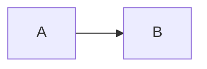

# 我的博客 · 使用手册

> 这份文档是给「第一次做博客」的人看的。前半部分解释你现在拥有了什么，后半部分是操作步骤。
> 主题官方文档：https://docs.shirone.mysqil.com/

---

## 0. 你现在的状态

已经跑通的事情：

| 项目 | 状态 |
| --- | --- |
| 主题源码 | 已下载到 `D:\MyBlog`，并提交为本地 git 仓库 |
| 运行环境 | Node 26.13.0 + pnpm 11.28.2（便携版，装在 `D:\tools\node-v26.13.0-win-x64`，没有改动你系统里的 Node） |
| 依赖 | 已安装（`node_modules/`，约 1383 个包） |
| 站点信息 | 已改成「叁月的博客 / 叁月」 |
| 你的第一篇文章 | `src/content/posts/hello-world.md` |
| 关于页 | `src/content/spec/about.md` |
| 主题示例文章 | 已移到 `_reference/demo-content/`（不进构建，随时可查语法） |
| 构建 | `pnpm build` 通过，产物在 `dist/`（493 个文件，29MB） |
| 上传包 | `dist.zip`（21.7MB，可直接拖到 EdgeOne） |
| 本地预览 | `pnpm preview` → http://localhost:4321 |

还没做、需要你本人操作的：注册腾讯云、注册 GitHub、把站点传到线上。原因很简单——这些要你的账号和实名认证，我没法替你点。

---

## 1. 先把六个名词搞懂

不搞懂这些，后面每一步都会像在背咒语。

**① 静态站点（static site）**
传统的博客（WordPress）是「有访客来 → 服务器现场查数据库 → 生成页面」。静态站点反过来：**在你自己电脑上，提前把所有页面生成成一堆 .html 文件**。访客来的时候，服务器只是把文件递过去。
好处：快、便宜、不会因为数据库崩了挂掉、几乎不可能被拖库。
代价：写新文章要「重新生成一次」，不能像 WordPress 那样在网页后台点发布。

**② 构建（build）**
就是上面说的「生成」动作。命令是 `pnpm build`，它把 `src/` 里的源码 + 你的文章，变成 `dist/` 里的成品网站。
`dist/` 是**产物**，每次构建都会被覆盖。**永远不要在 `dist/` 里改东西**，改了下次构建就没了。

**③ 托管（hosting）**
存放 `dist/` 让别人能访问的服务。我们选 EdgeOne Pages（腾讯云的免费静态托管，国内访问快）。

**④ 域名（domain）**
`example.com` 这种。EdgeOne 会先给你一个免费的默认域名（形如 `xxx.edgeone.app`），能直接用；以后想换成自己的域名再绑。

**⑤ DNS 解析**
把你买的域名「指向」托管平台的服务器。在域名商的后台加一条 CNAME 记录，告诉全世界「访问我这个域名，去 EdgeOne 那台机器拿文件」。

**⑥ Git / GitHub**
Git 是本地版本管理（已经初始化好了，在 `D:\MyBlog`）。GitHub 是网上的代码仓库。
把代码推到 GitHub 后，EdgeOne 就能「连着这个仓库」，你一推代码它自动重新构建——这就是「推一下，网站就更新了」。

> 备案：如果以后绑自己的域名、且要国内节点全速访问，中国大陆要求域名做 ICP 备案（免费，但要时间）。**没备案也能用**，EdgeOne 会把流量调度到境外/边缘节点。先用默认域名试，不影响你现在就上线。

---

## 2. 本地怎么看效果

打开 PowerShell，一次一行：

```powershell
. 'D:\tools\use-node26.ps1'   # 让当前窗口用 Node 26 + pnpm 11（只需每次新开窗口时执行）
Set-Location D:\MyBlog
pnpm dev                      # 开发模式，改文件浏览器里立刻刷新
```

然后浏览器打开 **http://localhost:4321**。`Ctrl+C` 停止。

改完想看「真正上线后的样子」，用生产预览：

```powershell
pnpm build      # 生成 dist/
pnpm preview    # 用 dist/ 起的服务器，和线上一致
```

`pnpm dev` 和 `pnpm preview` 的区别：前者是边改边看（慢一点、有调试代码），后者是成品。**判断「能不能发布」只看 `pnpm build` 是否成功。**

---

## 3. 把它改成你自己的

需要改的都在 `src/config/`，**每个字段上面都有中文注释**，直接读文件最准。最小集合是这三个：

### 3.1 站点信息 —— `src/config/siteConfig.ts`

```ts
site: "https://example.com/",   // ← 必须改！上线后填你的正式域名（末尾留斜杠）
base: "/",                      // 部署在域名根目录就保持 "/"
title: "叁月的博客",             // 站点名（顶栏、Banner、RSS）
subtitle: "把日常写成可以翻阅的样子",
lang: "zh_CN",                  // 界面语言，可选 en / zh_CN / zh_TW / ja / ko / es / id / th / tr / vi
```

`site` 为什么重要：RSS、Sitemap、分享卡片里的链接都是用它拼的绝对地址。**填错了站点能打开，但订阅和分享会指向错地方。** 换域名后必须改这里 + 重新构建。

同文件里还有：

- `themeColor.hue`（0–360）—— 全站主色的种子色。现在 315 是粉紫。想要紫色改 262，蓝 250，绿 140。改一个数字，整套配色自动重算。
- `banner` —— 首页大图。默认图在 `src/assets/images/banner/`，替换成你的图即可（同文件名最省事）。
- `banner.homeText.subtitle` —— 打字机效果的几行小字。
- `texture` —— 背景纹理（星空/樱花/几何…）。

### 3.2 个人资料 —— `src/config/profileConfig.ts`

头像、昵称、一句话简介、社交链接。头像放进 `src/assets/images/`，然后写相对 `src` 的路径（这样构建时会自动压成 WebP/AVIF）。

### 3.3 导航 —— `src/config/navBarConfig.ts`

顶栏有哪些入口。`LinkPresets` 是预设表，`links` 数组决定顺序。想在「更多」里挂自己的 GitHub，就改 `LinkPresets.GitHub.url`，再把注释掉的那行取消掉。

> 想删掉某个功能页：去它对应的 `*Config.ts` 把 `enable` 改成 `false`，导航入口会自动消失（不会留下点进去 404 的死链）。这是这个主题设计得好的地方。

### 3.4 哪些页面现在是「示例数据」

这些页面能打开，但内容是主题作者的示例，**换成你的或者关掉**：

| 页面 | 内容文件 | 开关 |
| --- | --- | --- |
| 友链 | `src/data/friends.ts`（现在是 Astro / Material 3 等参考站） | `friendsConfig.ts` → `enable` |
| 动态 | `src/content/moments/`（现在是空目录） | `momentsConfig.ts` |
| 番剧 | `src/data/anime.ts` | `animeConfig.ts` |
| 相册 | `public/images/albums/` + 相册配置 | `albumsConfig.ts` |
| 项目 | `src/data/projects.ts` | `projectsConfig.ts` |
| 技能 | `src/data/skills.ts` | `skillsConfig.ts` |
| 设备 | `src/data/devices.ts` | `devicesConfig.ts` |
| 游戏 | `src/data/games.ts` | `gamesConfig.ts` |
| 时间线 | `src/data/timeline.ts` | `timelineConfig.ts` |
| 站点罗盘 | `src/data/compass.ts` | `compassConfig.ts` |

规则很简单：**`config/` 管行为（开关、排序），`data/` 管内容（具体条目）**。

### 3.5 我替你做的两个决定（可以反悔）

1. **关掉了侧栏音乐**（`src/config/musicConfig.ts` → `enable: false`）。
   原因：它自带 4 首主题作者的示例 mp3，占 21MB，而且不是你选的歌。想开就把 `enable` 改回 `true`，并把 `src/data/music.ts` 换成自己的曲目；音频文件放 `public/assets/music/url/`（我从 `_reference/demo-assets/music/` 移出去了，那里有原件）。
2. **移走了 20 篇示例文章**（到 `_reference/demo-content/`）。
   原因：首页原本全是英文示例文章，不像你的博客。那些文件其实是**语法活文档**——想学 Mermaid、代码块、提示框怎么写，直接翻 `_reference/demo-content/posts/` 里的任意一篇，照抄结构。

---

## 4. 写文章

### 4.1 新建一篇

```powershell
. 'D:\tools\use-node26.ps1'
Set-Location D:\MyBlog
pnpm new-post 我的文章-slug
```

会在 `src/content/posts/` 生成 `我的文章-slug.md`，frontmatter 已经按站点时区算好了。

### 4.2 frontmatter 字段

```yaml
---
title: 必填，标题
published: 2026-11-11        # 必填，日历日期（决定归档和排序）
publishedAt: 2026-11-11T20:30:00+08:00   # 可选，同一天发多篇时用它排先后
updated: 2026-12-01          # 可选，更新日期
updatedAt: 2026-12-01T14:20:00+08:00     # 可选
description: 显示在列表、搜索结果和分享卡片里的摘要
image: ./cover.webp          # 封面图：相对本文的路径 / 以 / 开头的 public 路径 / 远程 URL
tags: [随笔, 建站]
category: 生活
draft: false                 # true = 草稿，不发布
pinned: false                # true = 置顶
comment: true                # 本文是否开放评论
encrypted: false             # 客户端加密（AES-256-GCM），true 时配 password/passwordHint
series: 系列slug             # 可选，属于哪个系列
seriesOrder: 1               # 可选，系列内顺序
license: CC BY 4.0           # 可选，单篇版权声明，覆盖全站默认
---
```

`published` 和 `publishedAt` **必须是同一天**（后者是前者的精确时刻），否则构建会报错。机器时区和这个无关，主题按 `siteConfig.timeZone`（默认 `Asia/Shanghai`）解释。

### 4.3 图片放哪

| 放哪 | 怎么写 | 适用 |
| --- | --- | --- |
| 文章同目录 | `` | 最推荐。图片跟着文章走，迁移方便；构建时自动生成多尺寸 WebP/AVIF |
| `src/assets/` | `assets/images/xx.webp` | 站点级图片（横幅、头像），同样享受优化 |
| `public/` | `` | 原图直出、不优化。只有「必须保持原格式」时才用 |

### 4.4 常用语法（都是原生的，不需要开关）

````markdown
:::note 标题
提示框。还有 :::info / :::tip / :::warning / :::caution / :::details
:::

> [!IMPORTANT]
> GitHub Alert 写法也认。

$$
E = mc^2
$$



密码保护（构建时加密，正文不会出现在 HTML 里）：
frontmatter 写 `encrypted: true` + `password: 你的密码` + `passwordHint: 提示`
````

更多见 `_reference/demo-content/posts/`——那 20 篇就是完整语法手册。

---

## 5. 部署到 EdgeOne Pages

你有两条路，**建议先走 A 上线，再走 B 自动化**。

### 路线 A：直接上传（今天就能上线）

1. 注册腾讯云账号（https://cloud.tencent.com/），完成实名认证。
2. 控制台搜索 **EdgeOne Pages** → 进入 → **创建项目** → 选 **直接上传**。
   ⚠️ 注意：**直接上传的项目以后不能改成 Git 集成**，想要自动部署必须新建一个项目。所以它适合「先看到东西」，长期还是用 B。
3. 填项目名、选加速区域，把 **`D:\MyBlog\dist` 文件夹**拖进去（或上传 `dist.zip`）。
4. 点「开始部署」，等 1–2 分钟，拿到 `xxx.edgeone.app` 的访问地址。

平台限制：单项目 ≤ 1000 个文件、单文件 ≤ 25MB。当前是 493 个文件、最大 3.7MB，**没超**。以后图片多了要注意——超了就得换 Git 构建或 EdgeOne CLI。

**以后更新**：改完 → `pnpm build` → 项目里「新建部署」→ 再拖一次 `dist`。
不想手打命令的话，双击仓库里的 `deploy.ps1`，它会自动构建并重新打包 `dist.zip`。

### 路线 B：Git 自动部署（推一下，网站就更新）

#### B1. 把代码放到 GitHub

你这台机器访问 GitHub 的 443 端口是被阻断的（我试过，HTTPS 连不上），但 **SSH 的 22 端口是通的**，所以用 SSH。

1. 注册 https://github.com ，新建一个仓库（建议 **Private**，名字随意，比如 `my-blog`）。**不要**勾选 "Add a README"，保持空仓库。
2. 生成 SSH 密钥（PowerShell）：

   ```powershell
   ssh-keygen -t ed25519 -C "你的邮箱"     # 一路回车，密码可留空
   Get-Content $env:USERPROFILE\.ssh\id_ed25519.pub
   ```

   复制打印出来的整行（`ssh-ed25519 AAAA...`）。
3. GitHub → 右上角头像 → **Settings** → **SSH and GPG keys** → **New SSH key** → 粘贴 → 保存。
4. 验证并推送：

   ```powershell
   ssh -T git@github.com          # 出现 "Hi 用户名! You've successfully authenticated" 就对了
   Set-Location D:\MyBlog
   git remote add origin git@github.com:你的用户名/my-blog.git
   git push -u origin main
   ```

> 如果 `ssh -T` 超时：改用国内仓库（Gitee）作中转，或给 SSH 配 `Host github.com / Port 443`（用 `ssh.github.com:443`）。443 端口我实测也是通的，只是 https 协议被封。

#### B2. EdgeOne 连仓库

1. EdgeOne Pages → **创建项目** → **导入 Git 仓库** → 授权 GitHub → 选 `my-blog`，生产分支 `main`。
2. 构建参数：

   | 配置项 | 填写 |
   | --- | --- |
   | 框架预设 | `Astro` 或「静态网站」 |
   | 构建命令 | `pnpm build` |
   | 输出目录 | `dist` |
   | Node.js 版本 | `24` |

3. 点部署。之后每次 `git push` 都会自动重新构建。

**几个必须知道的坑：**

- **Node 版本**：主题 `package.json` 写着 `>=26.13.0`，但 EdgeOne 最高只给 Node 24。我实测过：**用 Node 24 构建这个站是成功的**，所以照选 24。
- **必须用 pnpm**：主题有个 `preinstall` 钩子会强制校验包管理器，用 npm 装依赖会直接失败。如果控制台的安装命令能改，填 `pnpm install --frozen-lockfile`。
- **别把构建交给平台又同时上传 dist**：两套模式只能二选一。选了「导入 Git」就别再手动传 `dist`，反之要在平台里把构建命令清空。

### 5.1 绑定自己的域名（可选，以后再做）

1. 买域名（腾讯云/阿里云/Cloudflare 都行，几十块一年）。
2. EdgeOne 项目 → **域名管理** → **自定义域名** → 添加。
3. 去域名商后台加一条 **CNAME** 记录，指向 EdgeOne 给你的目标地址。
4. 等解析生效（几分钟到几小时），平台自动签 SSL 证书。
5. **改 `src/config/siteConfig.ts` 的 `site` 为新域名 → 重新构建 → 重新部署。** 忘这步会导致 RSS 和分享链接还是旧地址。

---

## 6. 上线后必做的三件事

1. **改 `site`**（见上）——否则 Sitemap/RSS 里全是 `example.com`。
2. **打开首页点一圈**：文章页、归档、分类、标签、关于、404、搜索（右上角放大镜）。
3. **提交站点给搜索引擎**（可选）：Google Search Console / Bing Webmaster 提交 `你的域名/sitemap-index.xml`。

---

## 7. 日常维护流程

```text
写文章（src/content/posts/xxx.md）
   ↓
pnpm dev  → 浏览器看效果（http://localhost:4321）
   ↓
pnpm build  → 通过？进入下一步；报错？看报错里的文件行号，多半是 frontmatter 字段写错
   ↓
路线A：拖 dist 到 EdgeOne ／ 路线B：git add . && git commit -m "新文章" && git push
```

只改文字不改配置时，甚至可以跳过 `dev`：写完直接 `pnpm build`，看有没有报错。

---

## 8. 我实际踩到的坑（以及怎么解决）

这些坑你以后换电脑、重装、或让别人帮你部署时还会遇到，记下来省时间。

| 现象 | 原因 | 解决 |
| --- | --- | --- |
| `git clone` 报 `Failed to connect to 127.0.0.1 port 1164` | 全局 git 配了一个不存在的代理 | 本次改用 `codeload.github.com` 直下 tar.gz；或 `git config --global --unset http.proxy` |
| `pnpm install` 报 `ERR_PNPM_MINIMUM_RELEASE_AGE_VIOLATION` | pnpm 11 的「最小发布年龄」校验，撞上 npmmirror 缺少 `@pagefind/*-arm64` 的元数据 | 在 `pnpm-workspace.yaml` 加了 `minimumReleaseAgeExclude: ["@pagefind/*"]`（这两个包本来就不是本平台要装的） |
| 构建报 `CannotFetchFontFile ... jetbrains-mono` | Astro 构建时要下载字体算度量，那次网络抖动 | 重试即通过；若反复失败，说明 jsDelivr 被断，需要换网络/代理 |
| 构建警告 `No files found matching "**/*.md" in directory src\content\series` | 清空示例后目录是空的 | 无害。已加 `.gitkeep` 保持目录存在；`seriesConfig.enable` 为 false 时也建议保持 |
| 改了文章但字体缺字/字重不对 | 字体子集有缓存，键是「字符集」本身 | 内容变了会自动重算；实在怀疑就删 `src/assets/fonts/.subset/` 再构建 |
| EdgeOne 只支持 Node 24，主题要 26 | 平台限制 | 实测 Node 24 构建通过，选 24 即可；或走「直接上传」绕开构建机 |

---

## 9. 资料地图（按需要读，别从头啃）

| 想了解 | 看哪里 |
| --- | --- |
| 主题全部配置项 | `src/config/README.md`（配置契约），以及各 `*Config.ts` 里字段上方的注释 |
| Markdown 能写什么 | `_reference/demo-content/posts/` 那 20 篇示例 |
| 官方文档 | https://docs.shirone.mysqil.com/ （部署看 `部署` 分组，写作看 `写作` 分组） |
| 组件怎么分层/怎么改样式 | `DESIGN.md`、`docs/m3e-standard.md`、`docs/atomic-structure.md` |
| 部署全部选项对比 | `INDEX.md`、https://docs.shirone.mysqil.com/guide/deploy/overview/ |
| 想让 AI 帮你改 | `.agents/skills/`（仓库自带一套 Shirone 专用技能，我在这个会话里用的就是它们） |

---

## 10. 一句话总结

**写文章 = 在 `src/content/posts/` 放一个 .md 文件；发布 = `pnpm build` 然后把 `dist/` 交出去。**
其余所有配置都在 `src/config/` 里，注释比文档还全。
